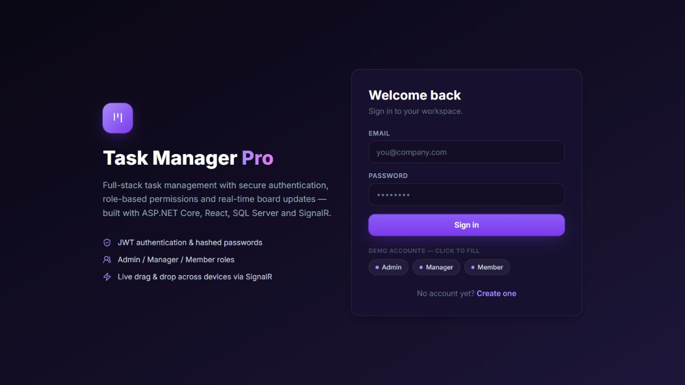

# Task Manager Pro

**Live application: [Open Task Manager Pro](https://task-manager-pro-p80i.onrender.com)**

Anyone can open the website and register a member account. Admin access requires the administrator credentials configured for deployment. The free hosting service may take about a minute to wake up after inactivity.

Full-stack task management application built with **ASP.NET Core 8, React 18 and TypeScript**, with JWT authentication, role-based permissions and real-time board updates via SignalR. Supports SQL Server, PostgreSQL and SQLite.

  

[Features](#features) · [Tech stack](#tech-stack) · [Quick start](#quick-start-no-sql-server-needed--sqlite-demo) · [API overview](#api-overview)

## Preview



*Captured from the live application on 30 October 2026.*

## Features

- **Authentication** — register/login with JWT bearer tokens, PBKDF2 (SHA-256, 100k iterations) password hashing, deactivated-account blocking.
- **Role permissions** — three roles enforced server-side:

  | Capability | Admin | Manager | Member |
  |---|:-:|:-:|:-:|
  | View board / tasks / dashboard | ✅ | ✅ | ✅ |
  | Create / delete tasks | ✅ | ✅ | ❌ |
  | Edit / move any task | ✅ | ✅ | only own |
  | Manage columns | ✅ | ✅ | ❌ |
  | Team management (roles, activate, delete) | ✅ | ❌ | ❌ |

- **Kanban board** — Week 1–4 columns (renameable/addable), HTML5 drag & drop with optimistic updates, position re-packing on the server, search + priority + assignee filters.
- **Real-time (SignalR)** — every create/edit/move/delete is broadcast to all connected clients instantly (`task:created`, `task:updated`, `task:deleted`, `board:sync`, `column:changed`, `user:changed`) with live toast notifications and a connection status indicator.
- **Dashboard analytics** — totals, completion rate, overdue tracking, per-column distribution, priority mix, per-user workload and "due soon" list.
- **Team management** — admin-only page to change roles, activate/deactivate and remove users, with self-protection guards.
- **Dashboard-ready SQL** — EF Core migrations **plus** a standalone T-SQL schema script (`Database/create_database.sql`).

## Tech stack

| Layer | Technology |
|---|---|
| API | ASP.NET Core 8, attribute routing, Swagger/OpenAPI |
| Auth | JWT bearer, PBKDF2 password hashing, role-based authorization policies |
| Real-time | SignalR (WebSocket with SSE/LongPolling fallback), JWT via query-string handshake |
| ORM | Entity Framework Core 8 — SQL Server, PostgreSQL and SQLite providers |
| Client | React 18 + TypeScript + Vite, Tailwind CSS, react-router v6, axios, @microsoft/signalr, lucide-react |
| Database | SQL Server (T-SQL schema + indexes + FKs), PostgreSQL for the Render blueprint, or SQLite for local demos |

## Project structure

```
task-manager-pro/
├── package.json                # root scripts (npm start → start.sh)
├── start.sh                    # one-command launcher (builds SPA if needed, runs API)
├── Dockerfile                  # multi-stage container build (SDK → aspnet runtime)
├── Procfile                    # for Procfile-based platforms (web: bash start.sh)
├── .gitignore
├── server/
│   ├── TaskManagerPro.sln
│   └── TaskManagerPro.Api/
│       ├── Controllers/        # Auth, Tasks, Columns, Users, Stats
│       ├── Entities/           # User, TaskItem, BoardColumn
│       ├── Data/               # AppDbContext + DbSeeder (demo data)
│       ├── DTOs/               # request/response records with validation
│       ├── Hubs/               # SignalR TaskHub
│       ├── Services/           # TokenService, PasswordHasher
│       ├── Migrations/         # EF Core InitialCreate migration
│       ├── Database/           # create_database.sql (T-SQL for SQL Server)
│       ├── wwwroot/            # pre-built React SPA (ready to serve)
│       └── Program.cs          # DI, auth, CORS, hub, SPA hosting
├── client/
│   └── src/
│       ├── api/                # axios client + SignalR connection factory
│       ├── context/            # AuthContext, DataContext (real-time state), Toasts
│       ├── components/         # Sidebar, Topbar, TaskCard, TaskModal, ui kit
│       └── pages/              # Login, Register, Dashboard, Board, Tasks, Team
└── tests/
    └── test_api.py             # 23-test end-to-end API suite
```

## Quick start (no SQL Server needed — SQLite demo)

```bash
# 1. API (http://localhost:5000, Swagger at /swagger)
cd server/TaskManagerPro.Api
dotnet run -- --sqlite

# 2. Client dev server (http://localhost:5173, proxies /api + /hubs)
cd client
npm install
npm run dev
```

The SQLite provider creates and seeds the database automatically on first run.

## Running with SQL Server

1. Create the database — either let EF Core do it (recommended):
   ```bash
   cd server/TaskManagerPro.Api
   dotnet ef database update        # or just run the API; it calls Migrate() on startup
   ```
   …or run the DBA-style script instead: `sqlcmd -S localhost,1433 -U sa -P <pwd> -i Database/create_database.sql`.

2. Point the API at your instance in `server/TaskManagerPro.Api/appsettings.json`:
   ```json
   "ConnectionStrings": {
     "SqlServer": "Server=localhost,1433;Database=TaskManagerPro;User Id=sa;Password=YourStrong!Passw0rd;TrustServerCertificate=True;MultipleActiveResultSets=true"
   }
   ```
   Windows auth variant: `Server=localhost;Database=TaskManagerPro;Trusted_Connection=True;TrustServerCertificate=True;`

3. Run: `dotnet run` (provider defaults to `SqlServer`).

### Local demo seed accounts

These accounts are for the seeded local demo. The Render blueprint disables demo seeding and uses configured bootstrap administrator credentials.

| Role | Email | Password |
|---|---|---|
| Admin | `admin@taskmanager.pro` | `Admin@123` |
| Manager | `manager@taskmanager.pro` | `Manager@123` |
| Member | `member@taskmanager.pro` | `Member@123` |
| Member | `jordan@taskmanager.pro` | `Member@123` |

## Production build (single origin)

The client build outputs to `server/TaskManagerPro.Api/wwwroot`, so the API serves the SPA directly:

```bash
cd client && npm run build
cd ../server/TaskManagerPro.Api && dotnet run -c Release
```

## One-command start

From the project root (`.NET 8 SDK` required; the repo ships with a pre-built SPA in `wwwroot`, so Node is only needed if you rebuild the client):

```bash
bash start.sh            # SQLite demo mode on http://0.0.0.0:3000 (override with PORT=...)
npm start                # same thing via package.json
```

## Deployment options

**Self-contained publish** (no .NET runtime needed on the target host — runtime is bundled):

```bash
cd server/TaskManagerPro.Api
dotnet publish -c Release -r linux-x64 --self-contained true -o ../../deploy/app
./deploy/app/TaskManagerPro.Api --urls http://0.0.0.0:3000 --sqlite   # or without --sqlite for SQL Server
```

RIDs: `linux-x64`, `linux-arm64`, `win-x64` (produces `TaskManagerPro.Api.exe`).

**Docker:**

```bash
docker build -t task-manager-pro .
docker run -p 3000:3000 task-manager-pro                    # SQLite demo
# for SQL Server, override the entrypoint args / connection string env
```

**Procfile platforms** (Heroku/Fly/Render-style): the repo includes a `Procfile` (`web: bash start.sh`) — the platform just needs .NET 8 SDK available.

**Tests** (pure Python stdlib — no pip installs needed):

```bash
python tests/test_api.py                       # runs against http://localhost:3000
API_BASE=http://localhost:5000 python tests/test_api.py   # custom target
```

Covers: auth flows, 401/403 role guards, task CRUD, drag-drop move persistence, dashboard stats, column management — 23 checks total.

## API overview

| Method | Route | Access |
|---|---|---|
| POST | `/api/auth/register` | public |
| POST | `/api/auth/login` | public |
| GET | `/api/auth/me` | authenticated |
| GET | `/api/columns` | authenticated |
| POST/PUT | `/api/columns[...]` | Admin, Manager |
| DELETE | `/api/columns/{id}` | Admin |
| GET | `/api/tasks` | authenticated |
| POST | `/api/tasks` | Admin, Manager |
| PUT | `/api/tasks/{id}` | Admin/Manager or assignee |
| PUT | `/api/tasks/{id}/move` | Admin/Manager or assignee |
| DELETE | `/api/tasks/{id}` | Admin, Manager |
| GET | `/api/stats/dashboard` | authenticated |
| GET/PUT/DELETE | `/api/users[...]` | Admin |

Real-time hub: `/hubs/tasks` (JWT via `?access_token=`).

## Notes & extension ideas

- JWT expiry is 12h (`Jwt:ExpiryHours`); swap in refresh tokens for production.
- Column names/colors are fully editable — rename "Week 1..4" to any workflow (To Do → Done).
- The last board column (highest position) is treated as "completed" for dashboard metrics.
- Ideas: task comments, file attachments, email notifications, per-project boards, dark/light toggle.

## Free deployment: Render + Neon PostgreSQL

The `render.yaml` Blueprint deploys the React frontend and .NET API together on Render's Free plan. Use a separate Neon Free PostgreSQL database so app restarts do not erase data. Free services have usage limits and may sleep when idle.

1. Sign up at https://console.neon.tech using GitHub. Create a Free project with a new, empty database.
2. Open Connect and choose the .NET/Npgsql connection string format. It must look like `Host=...;Database=neondb;Username=...;Password=...;SSL Mode=Require`. Do not paste a `postgresql://` URL into this setting.
3. Open https://dashboard.render.com/select-repo?type=blueprint and select this repository. Keep the service on the Free plan.
4. Enter the requested secrets directly in Render:
   - `ConnectionStrings__Postgres`: the Npgsql connection string from Neon.
   - `Bootstrap__AdminEmail`: your chosen admin email.
   - `Bootstrap__AdminPassword`: a unique password of at least 12 characters.
5. Deploy the Blueprint. Open the generated HTTPS URL and log in with the admin credentials above.

Render generates a JWT signing key. Demo accounts and tasks are disabled for this deployment. Admin credentials are used only when the database has no users; changing these settings later does not change an existing account's password. Keep the signing key stable across redeployments.

The PostgreSQL schema is created automatically for an empty database using EF Core EnsureCreated. Existing SQL Server migrations are not applied to PostgreSQL. Future schema changes require a PostgreSQL migration strategy. Your local SQLite records are not automatically copied to Neon.

Never commit database connection strings, passwords, or deployment credentials to GitHub. A live PostgreSQL connection is required to verify the deployed database integration.
